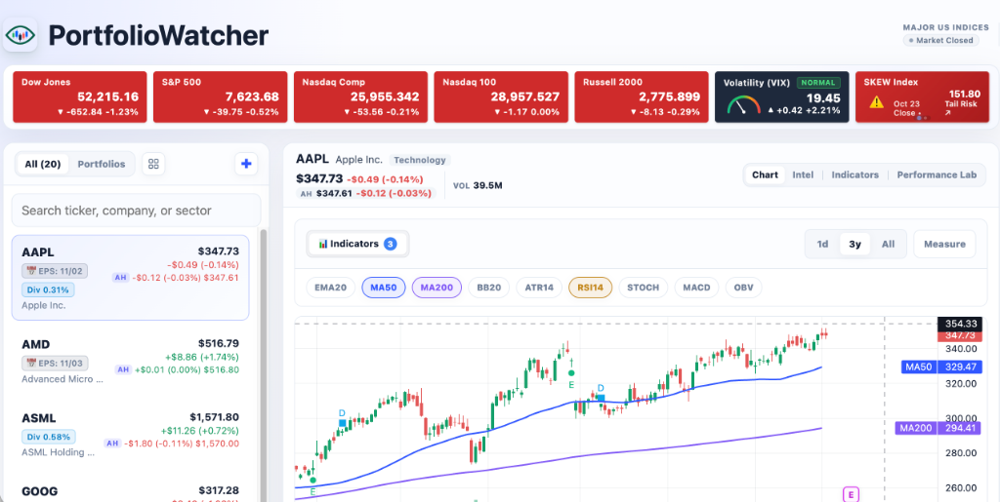
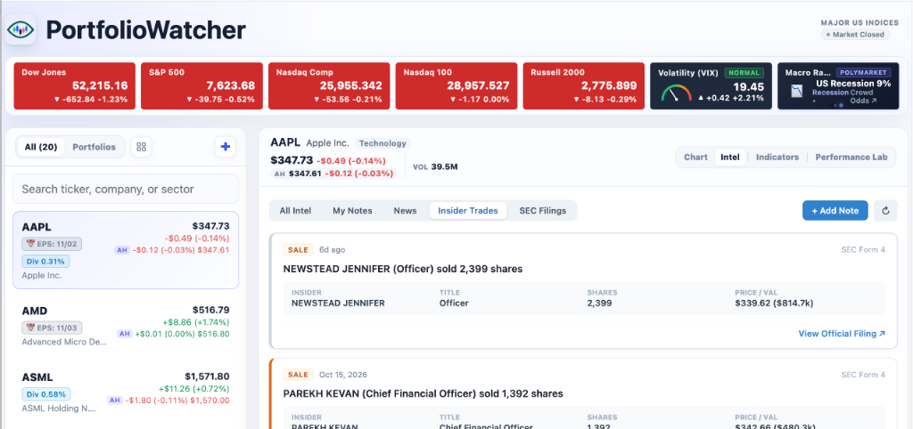
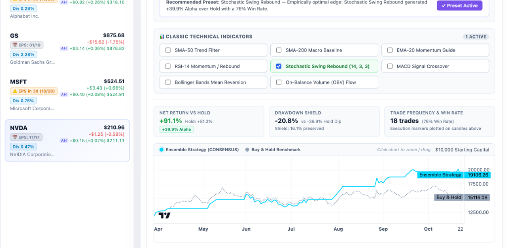

# PortfolioWatcher

[](LICENSE)

> A local-first stock tracking and portfolio tool for mid- to long-term investors.

---

## Why It Was Built

As a self-directed investor managing mid-to-long-term positions, it is frustrating with existing tools:

- **"Is my portfolio positioned right?"** — Broker sites give you rigid tables and don't let you organize stocks the way you actually think.
- **"What if I had done things differently?"** — Most charting sites show price in isolation, with no easy way to study how simple strategies or indicators might have impacted your holdings.
- **"What should I do next?"** — Staring at daily price noise and commentary often just leads to hesitation and decision fatigue.

PortfolioWatcher is a personal project to explore a better way: a local workspace that brings together stock lists, charts, basic fundamentals, and strategy experimentation.

It provides a hackable starting point you can run locally and adapt to your own workflow.

---

## What's Inside

- **Personal Stock & Portfolio Views**: Group holdings into custom baskets, section dividers, and view things your way.
- **Interactive Candlestick Charts**: Price history with common technical indicators and earnings/dividend event markers.
- **Fundamentals & Catalysts**: Quick glance at earnings calendars, EPS surprises, and dividend payouts.
- **Strategy Performance Lab & Asset DNA**: Automatically analyzes each stock's behavioral DNA (volatility regime, trend persistence, and cycle profile) and backtests active indicator overlays to explore opportunities for alpha and drawdown defense compared to passive buy-and-hold.
- **AI-Ready (MCP & Agent Skills)**: Built-in Model Context Protocol server and ready-to-use skills (`examples/skills/`) to connect your portfolio with AI assistants (Claude, Cursor, ChatGPT) for automated research and morning briefings.
- **100% Local & Hackable**: Runs on SQLite on your own machine with zero cloud dependencies.

---

## Preview

### 1. Chart & Technical Indicators


### 2. Stock Intel & Catalysts


### 3. Strategy Performance Lab & Asset DNA

*Automated Asset DNA diagnostics and backtesting to evaluate active strategies versus passive buy-and-hold.*

---

## Quick Start

### First-Time Setup

1. **Backend**
   ```bash
   cd backend
   python -m venv .venv
   source .venv/bin/activate    # Windows: .venv\Scripts\activate
   pip install -r requirements.txt
   python -m portfolio.data.seed_demo
   python app.py
   ```
   *Backend runs at `http://127.0.0.1:5739`.*

2. **Frontend**
   ```bash
   cd frontend
   npm install
   npm run dev
   ```
   *Open `http://localhost:5175`.*

### Subsequent Runs

Once installed, simply activate and start each service:

1. **Backend**
   ```bash
   cd backend
   source .venv/bin/activate    # Windows: .venv\Scripts\activate
   python app.py
   ```

2. **Frontend**
   ```bash
   cd frontend
   npm run dev
   ```

> [!NOTE]
> **Market Data Synchronization (Auto-Sync & Manual Fallback)**:
> - **Background Auto-Sync**: The backend runs a built-in background scheduler daemon that checks every 30 seconds. On weekdays at **16:45 ET** (45 minutes after market close), it automatically fetches official closing daily candlesticks and updates indicators for all tracked stocks.
> - **Non-24/7 Usage & Manual Sync**: Because PortfolioWatcher is typically run locally on a desktop or laptop rather than a 24/7 server, the auto-sync daemon will not fire if your computer is sleeping or the backend process is shut down during the 16:45 ET window.
> - **Manual Sync Button**: Whenever you start the app, or if you ever notice missing candlesticks or stale daily data, simply click the **Sync** button under **Tracked Stocks** in the left sidebar to manually pull the latest closing prices and indicator series on demand.

---

## Documentation

- **[DEVELOPMENT.md](DEVELOPMENT.md)**: Developer setup, database commands, and API reference.
- **[MCP.md](MCP.md)**: Model Context Protocol setup and agent skills (`examples/skills/`) for AI assistant integration.

---

## Ecosystem

- **[foliowatcher.com](https://foliowatcher.com)**: An extended cloud platform built around these concepts with quantitative alpha screening and multi-tenant management.

---

## License

GNU Affero General Public License v3.0 (AGPLv3). Free and open source.
